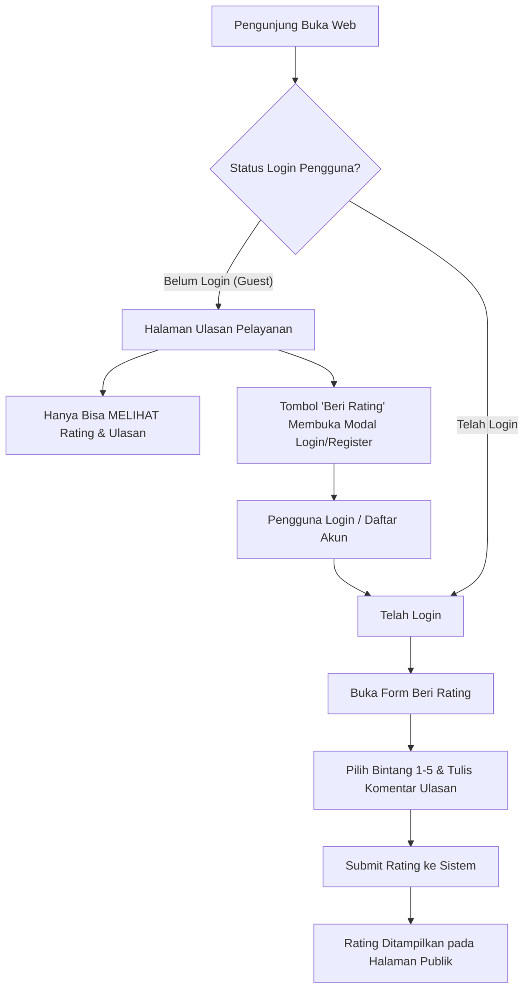
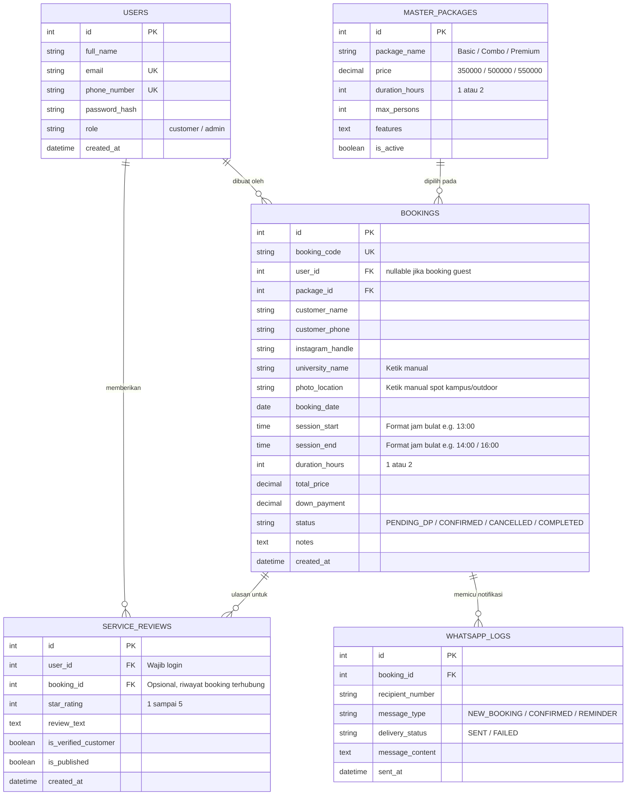

# Product Requirement Document (PRD)
## Aplikasi Booking Foto Wisuda (Graduation Photo Booking System)

---

### Informasi Dokumen
| Atribut | Keterangan |
| :--- | :--- |
| **Nama Usaha & Brand** | **UTARA GRADU** (Instagram: `@utara.photo`) |
| **Kontak WhatsApp** | **082120776606** (a/n Tara) |
| **Nama Proyek** | Sistem Informasi & Booking Foto Wisuda |
| **Versi Dokumen** | v1.3.0 (Penyesuaian Brand UTARA GRADU & Deskripsi Foto Diedit) |
| **Tanggal Pembaruan** | 2026-10-26 |
| **Status Dokumen** | Final - Aktif |
| **Target Rilis** | MVP (Fase 1) |

---

## 1. Ringkasan Eksekutif (Executive Summary)
Aplikasi Booking Foto Wisuda adalah platform web responsif yang dirancang untuk mempermudah calon wisudawan melakukan reservasi sesi pemotretan wisuda *on-location* (area kampus / spot outdoor) secara mandiri, transparan, dan terstruktur.

Platform ini mengintegrasikan katalog paket (durasi 1 jam untuk Basic, 2 jam untuk Combo & Premium), pemilihan slot waktu per jam bulat, pengisian data pelanggan yang fleksibel (nama kampus dan lokasi diketik manual), konfirmasi instan via WhatsApp, serta **fitur Rating & Ulasan Pelayanan**. Sistem rating ini bersifat transparan untuk umum (dapat dilihat oleh semua pengunjung tanpa login), namun pemberian rating diproteksi khusus untuk pengguna yang telah melakukan login ke dalam akun sistem guna menjamin keaslian ulasan.

---

## 2. Latar Belakang & Permasalahan (Problem Statement)
1. **Jadwal Bentrok (Double Booking):** Kesulitan mengelola slot waktu pemotretan wisudawan secara manual di hari-H wisuda.
2. **Kebutuhan Fleksibilitas Lokasi:** Sesi foto wisuda outdoor membutuhkan titik temu yang spesifik di area kampus yang diketik langsung oleh wisudawan.
3. **Kredibilitas Layanan & Kepercayaan Pelanggan (Social Proof):** Calon pelanggan wisuda baru ragu memilih fotografer tanpa melihat testimoni dan kepuasan wisudawan sebelumnya.
4. **Validitas & Integritas Ulasan:** Rating bebas tanpa login berisiko menimbulkan *spam review* atau ulasan palsu dari pihak yang tidak bertanggung jawab. Diperlukan gerbang autentikasi agar hanya pengguna login yang dapat mengirimkan ulasan, sementara publik tetap bebas melihat ulasan sebagai referensi.

---

## 3. Tujuan Produk & Metrik Keberhasilan (Goals & KPIs)

### 3.1. Tujuan Produk
- Menyediakan katalog paket foto wisuda yang jelas dengan durasi pasti (1 jam dan 2 jam).
- Mempermudah registrasi pesanan dengan input manual nama universitas dan lokasi foto outdoor.
- Menjamin slot waktu pemotretan teratur dengan sistem slot per jam bulat yang bebas tumpang tindih.
- Mengirimkan konfirmasi dan instruksi pembayaran DP secara instan ke WhatsApp.
- **Membangun Social Proof:** Menampilkan rating dan testimoni kepuasan pelanggan secara publik.
- **Menjaga Kualitas Ulasan:** Membatasi hak pemberian rating hanya kepada pengguna terautentikasi (login).

### 3.2. Key Performance Indicators (KPIs)
- **Engagement Rating:** Minimal 60% pelanggan yang telah selesai sesi pemotretan memberikan rating pelayanan.
- **Tingkat Kepuasan:** Rata-rata rating kepuasan pelayanan > 4.7 / 5.0 bintang.
- **Validitas Ulasan:** 0% spam review karena kewajiban login sebelum mengirimkan ulasan.
- **Ketiadaan Jadwal Bentrok:** 0% insiden jadwal pemotretan bentrok.

---

## 4. Target Pengguna & Hak Akses (User Roles & Permissions)

| Tipe Pengguna | Hak Akses Fitur |
| :--- | :--- |
| **Pengunjung Publik (Guest - Belum Login)** | • Melihat katalog paket & ketersediaan slot waktu.<br>• Melakukan pemesanan booking wisuda.<br>• **Melihat daftar rating, skor rata-rata bintang, dan ulasan pelayanan.**<br>• *Tidak dapat menuliskan rating (diarahkan untuk login terlebih dahulu).* |
| **Pelanggan Terdaftar (Customer - Telah Login)** | • Semua hak akses Guest.<br>• Melihat riwayat pesanan sesi fotonya.<br>• **Memberikan rating bintang (1–5) dan ulasan teks pelayanan.**<br>• Mengedit atau menghapus ulasan yang telah dibuatnya sendiri. |
| **Admin / Fotografer (Owner)** | • Mengelola Master Data Paket, Rekening, dan Jam Operasional.<br>• Memantau kalender jadwal dan memverifikasi pembayaran DP.<br>• **Moderasi ulasan rating (sembunyikan ulasan mengandung unsur sara/spam jika diperlukan).** |

---

## 5. Ruang Lingkup Produk (Product Scope)

### 5.1. Dalam Lingkup (In-Scope - Fase 1 / MVP)
- Halaman katalog 3 paket wisuda (Basic, Combo, Premium) beserta rincian durasi (1 jam & 2 jam).
- Sistem pemilihan tanggal dan slot waktu per jam bulat (dinamis sesuai durasi paket).
- Form registrasi customer dengan input teks langsung untuk Nama Universitas dan Lokasi Foto.
- Modul Master Data (Manajemen Paket, Pengaturan Jam Operasional & Slot, Data Rekening, Template WA).
- Integrasi konfirmasi otomatis ke WhatsApp (Customer & Admin).
- **Modul Autentikasi Pengguna (Login & Registrasi Sederhana menggunakan Email/No. WhatsApp & Password).**
- **Modul Rating Pelayanan (Public Read-Only untuk Guest, Write-Access untuk User Login).**
- Panel Admin untuk manajemen pesanan dan moderasi rating.

### 5.2. Di Luar Lingkup (Out-of-Scope)
- Layanan foto studio indoor (seluruh sesi difokuskan pada sesi *outdoor / on-campus*).
- Integrasi payment gateway otomatis (Fase 1 menggunakan transfer bank manual dengan bukti via WhatsApp).

---

## 6. Spesifikasi Fitur & Fungsionalitas



---

### 6.1. Modul 1: Pilihan Paket Wisuda

| Nama Paket | Harga (IDR) | Durasi Sesi | Cakupan Layanan Standar | Rekomendasi Penggunaan |
| :--- | :--- | :--- | :--- | :--- |
| **Basic** | **Rp 350.000** | **1 Jam** (60 Menit) | • 1 Orang Wisudawan (Solo)<br>• **20 Foto diedit (High-Resolution)**<br>• **Semua file original / mentah (Google Drive)**<br>• Sesi foto di spot kampus / outdoor pilihan customer | Wisudawan solo yang menginginkan dokumentasi personal yang ringkas dan berkualitas. |
| **Combo** | **Rp 500.000** | **2 Jam** (120 Menit) | • Wisudawan + Maks. 4 Pendamping (Keluarga/Sahabat)<br>• **30 Foto diedit (High-Resolution)**<br>• 1 Buah Cetak 10R + Bingkai Minimalis<br>• **Semua file original / mentah (Google Drive)**<br>• Eksplorasi multi-spot di area kampus / outdoor | Sesi wisudawan bersama keluarga inti atau lingkaran sahabat dekat dengan waktu santai. |
| **Premium** | **Rp 550.000** | **2 Jam** (120 Menit) | • Wisudawan + Maks. 8 Pendamping<br>• **30 Foto diedit (High-Resolution)**<br>• 1 Buah Cetak 12R/16R + Bingkai Eksklusif<br>• **Semua file original / mentah (Google Drive)**<br>• Prioritas proses editing kilat (3 hari kerja)<br>• Bebas ganti konsep properti foto | Paket terlengkap dengan jumlah foto edit lebih banyak dan cetakan bingkai eksklusif. |

---

### 6.2. Modul 2: Registrasi & Form Booking Customer

Formulir dirancang sederhana dan cepat diisi dari perangkat smartphone:

| Field Input | Tipe Komponen | Aturan Validasi | Keterangan & Perilaku |
| :--- | :--- | :--- | :--- |
| **Pilihan Paket** | Card Selection | Wajib | Basic (1 jam), Combo (2 jam), atau Premium (2 jam). |
| **Tanggal Sesi** | Date Picker | Wajib, min. H+1 dari hari ini | Menentukan tanggal pelaksanaan pemotretan. |
| **Slot Jam Sesi** | Time Slot Buttons / Select | Wajib, hanya slot yang kosong | **Sistem Jam Bulat:**<br>• Paket **Basic (1 Jam)**: `08.00 - 09.00`, `13.00 - 14.00`, `14.00 - 15.00`, dll.<br>• Paket **Combo/Premium (2 Jam)**: `08.00 - 10.00`, `13.00 - 15.00`, `14.00 - 16.00`, dll. |
| **Nama Lengkap** | Text Input | Wajib, min. 3 karakter | Nama wisudawan untuk identitas reservasi. |
| **Nomor Telepon / WA** | Tel Input | Wajib, format Indonesia (`08xx` atau `+628xx`) | Nomor WhatsApp aktif untuk pengiriman konfirmasi & koordinasi. |
| **Nick Instagram** | Text Input | Opsional, format `@username` | Username akun Instagram wisudawan untuk penandaan (*tagging*). |
| **Nama Universitas** | Text Input (Ketik Manual) | Wajib, min. 2 karakter | **Diketik sendiri oleh customer** (tanpa dropdown). Contoh: *Universitas Indonesia*, *UNPAD*, dll. |
| **Lokasi Photo** | Text Input / Textarea (Ketik Manual) | Wajib, min. 3 karakter | **Diketik sendiri oleh customer** (tanpa opsi studio). Titik temu spot kampus/outdoor. Contoh: *Gedung Rektorat Kampus A*, *Taman Danau*, dll. |
| **Catatan Tambahan** | Textarea | Opsional | Catatan khusus dari customer (misal: "Bawa balon wisuda"). |

---

### 6.3. Modul 3: Rating & Ulasan Pelayanan (Service Reviews)

Fitur untuk menampilkan reputasi fotografer dan mengumpulkan umpan balik pelanggan:

#### A. Akses Publik (Guest - Tanpa Login)
- Pengunjung dapat melihat:
  - Nilai rata-rata rating keseluruhan (skor 1.0 - 5.0 bintang).
  - Total jumlah ulasan yang telah masuk.
  - Grafik distribusi bintang (persentase bintang 5, 4, 3, 2, 1).
  - Kartu ulasan pelanggan (nama pemberi ulasan, jumlah bintang, tanggal ulasan, nama universitas, dan komentar ulasan).
- Jika pengunjung menekan tombol **"Beri Ulasan / Tulis Rating"**, sistem akan menampilkan popup/modal pesan:
  > *"Untuk memberikan rating dan ulasan pelayanan, silakan masuk (login) ke akun Anda terlebih dahulu."*
  > Dilengkapi tombol: `[Masuk ke Akun]` atau `[Daftar Akun Baru]`.

#### B. Akses Pelanggan Terdaftar (Logged-in User)
- Tombol **"Beri Ulasan"** langsung membuka modal form input ulasan:
  - **Skor Bintang:** Selector bintang interaktif 1 hingga 5 bintang (wajib dipilih).
  - **Ulasan Teks:** Textarea feedback (minimal 10 karakter, maksimal 500 karakter). Contoh: keramahan fotografer, arahan pose, ketepatan waktu hadir di kampus, hasil foto.
  - **Label Terverifikasi (Verified Customer):** Apabila user memiliki riwayat booking yang telah berstatus `COMPLETED`, ulasan akan mendapatkan badge khusus `✓ Verified Customer`.
- Tombol **Kirim Ulasan**: Rating langsung tersimpan dan otomatis memperbarui nilai rata-rata rating sistem.

#### C. Moderasi Rating (Sisi Admin)
- Admin dapat melihat semua daftar rating masuk di Dashboard Admin.
- Opsi untuk mengubah status ulasan (`published` / `hidden`) untuk menangkal ulasan bermuatan kata-kata kasar atau spam.

---

### 6.4. Modul 4: Autentikasi Pengguna (User Auth)

1. **Registrasi Akun Customer:**
   - Field: Nama Lengkap, Nomor WhatsApp, Email, dan Password.
2. **Login Akun:**
   - Input: Email atau Nomor WhatsApp + Password.
   - Fitur "Ingat Saya" (Remember Me).
3. **Manajemen Sesi:**
   - Token-based session / cookies session aman.
   - Status login tercermin di navigasi header (menampilkan Avatar & Nama User, serta tombol Logout).

---

### 6.5. Modul 5: Modul Master Data (Panel Admin)

1. **Master Paket Wisuda:** CRUD paket (Basic, Combo, Premium), pengaturan harga, durasi sesi (1 jam / 2 jam), dan status aktif.
2. **Master Jam Operasional & Jadwal:** Penentuan jam kerja (misal: 07.00 - 18.00), slot generator jam bulat, pemblokiran tanggal libur.
3. **Master Rekening Pembayaran:** Pengaturan data bank untuk penerimaan DP.
4. **Master Template Notifikasi WhatsApp:** Pengaturan format pesan dinamis konfirmasi booking.
5. **Master Moderasi Rating:** Kontrol penayangan testimoni pelanggan.

---

### 6.6. Modul 6: Integrasi & Konfirmasi WhatsApp

Sistem mengirimkan pesan WhatsApp secara instan dengan rincian data pesanan:

#### 1. Template Pesan: Konfirmasi Booking Baru (Ke Customer)
```text
Halo Kak {nama_customer}! 🎓📸

Terima kasih telah memesan sesi foto wisuda. Reservasi Kakak telah kami catat dalam antrean:

📋 KODE BOOKING: #{booking_code}
📦 Paket: {nama_paket} (Durasi {durasi_paket})
💰 Total Biaya: Rp {harga_paket}
🗓 Tanggal Sesi: {tanggal_sesi}
⏰ Jam Sesi: {jam_mulai} - {jam_selesai} WIB
🏛 Universitas: {nama_univ}
📍 Lokasi Foto: {lokasi_photo}
📸 Instagram: @{nick_ig}

Untuk mengunci slot jadwal Kakak secara resmi, mohon lakukan pembayaran Down Payment (DP) sebesar Rp 100.000 ke:
🏦 Bank BCA: 1234-5678-90
👤 a/n: Tara (UTARA GRADU)
⏳ Batas Waktu: Maksimal 2 jam dari sekarang

Kirimkan bukti transfer dengan membalas pesan ini atau klik link konfirmasi berikut:
🔗 {link_konfirmasi_wa}

Terima kasih dan sampai bertemu di hari bahagia Kakak! ✨
Salam hangat,
Tara - UTARA GRADU (@utara.photo)
```

#### 2. Template Pesan: Notifikasi Pesanan Baru (Ke Admin)
```text
🔔 PESANAN BOOKING WISUDA BARU!

Kode: #{booking_code}
Nama: {nama_customer} ({no_telpon})
Paket: {nama_paket} ({durasi_paket})
Jadwal: {tanggal_sesi} | {jam_mulai} - {jam_selesai} WIB
Kampus: {nama_univ}
Lokasi: {lokasi_photo}

Segera cek mutasi pembayaran DP di dashboard admin:
🔗 {link_admin_dashboard}
```

---

## 7. Desain Arsitektur Data (Entity Relationship)



---

## 8. Logika Penjadwalan & Validasi Jam Bulat

1. **Rentang Jam Operasional:** Pukul `07.00` hingga `18.00` WIB.
2. **Paket Basic (1 Jam):**
   - Opsi slot yang dihasilkan: `07.00 - 08.00`, `08.00 - 09.00`, `09.00 - 10.00`, `10.00 - 11.00`, `11.00 - 12.00`, `13.00 - 14.00`, `14.00 - 15.00`, `15.00 - 16.00`, `16.00 - 17.00`, `17.00 - 18.00`.
3. **Paket Combo & Premium (2 Jam):**
   - Opsi slot yang dihasilkan: `08.00 - 10.00`, `10.00 - 12.00`, `13.00 - 15.00`, `14.00 - 16.00`, `15.00 - 17.00`, `16.00 - 18.00`.
4. **Pencegahan Double-Booking:**
   - Suatu slot dinyatakan tidak tersedia (disabled) jika jam tersebut telah terisi oleh booking lain yang berstatus aktif pada tanggal yang sama.

---

## 9. Rencana Implementasi

| Tahap | Aktivitas | Hasil |
| :--- | :--- | :--- |
| **Tahap 1: Setup & Master Data** | • Skema database (`users`, `packages`, `bookings`, `service_reviews`, `whatsapp_logs`)<br>• CRUD Master Paket Wisuda (durasi 1 jam & 2 jam)<br>• Konfigurasi rekening pembayaran | Modul Master Data siap |
| **Tahap 2: Autentikasi Pengguna** | • Form Registrasi & Login Customer / Admin<br>• Proteksi sesi (Session / LocalStorage / JWT Token)<br>• Header navigasi responsif dengan status login | Sistem autentikasi pengguna aktif |
| **Tahap 3: Form Booking & Algoritma Slot** | • Katalog paket wisuda & Datepicker<br>• Generator slot jam bulat otomatis (1 jam / 2 jam)<br>• Input manual universitas dan lokasi foto outdoor | Form pemesanan responsif & anti-bentrok |
| **Tahap 4: Fitur Rating Pelayanan & WhatsApp** | • Halaman publik daftar ulasan & kalkulasi rating bintang<br>• Modal beri ulasan (write-review) diproteksi khusus user login<br>• Integrasi notifikasi WhatsApp otomatis | Fitur rating dan notifikasi WhatsApp berjalan |
| **Tahap 5: Panel Admin & Uji Coba** | • Kalender booking & konfirmasi pembayaran DP<br>• Moderasi ulasan rating<br>• Pengujian menyeluruh & deployment | Aplikasi siap digunakan secara publik |
